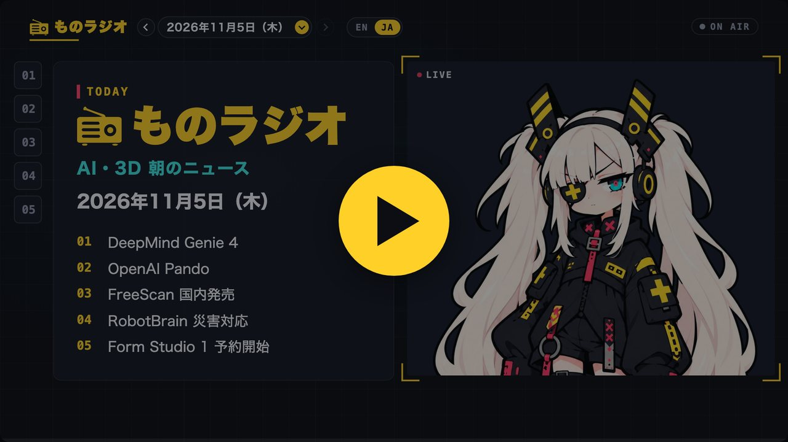

<h1 align="center">myradio</h1>

<p align="center"><b>キャラクターが毎朝ニュースを読む「放送局」を、<br>GitHub のリポジトリ 1 つで開けます。</b></p>

<!-- 複製して自分の局にしたら：この画像（docs/screen.jpg、ものラジオの画面）と下の ON AIR バッジを、自分の局のものに差し替えてください（AGENTS.md の「新しい局を開くとき」） -->
<p align="center">
  <a href="https://monoradio102.github.io/myradio/"></a>
</p>

<p align="center">
  <a href="https://monoradio102.github.io/myradio/"></a>
  <a href="#開局方法"></a>
</p>

<p align="center">このリポジトリが、そのまま 1 つの局です。<br>お手本の局「<b>ものラジオ</b>」（AI・3D の朝のニュース）が、毎朝放送中。</p>

- **配信は、台本と音声を置いて push するだけ**。サーバーはいりません
- 動画ではなく **HTML の番組**です。再生位置に合わせて、スライド・字幕・キャラ・リンクカードが動きます。見出しで飛べて、元の記事にすぐ行けて、台本はいつでも文字で読めます
- **ニュースの画像は、記事のサイトがサムネイル用に公開している画像（OGP）です**。SNS でリンクを貼ったときに出るのと同じ画像を、そのサイトから直接表示して、記事へのリンクを添えます。画像を保存したり配り直したりしないので、著作権に配慮した作りです
- **番組の中身は、文字の台本（JSON）です**。音声はそれを読み上げたもので、公開するのは直近 30 日分だけ。台本はずっと残るので、過去の回も記事として読めますし、別の声やキャラで作り直すこともできます
- 1 回分は台本と音声で 1MB ほど。同じ長さの動画の数十分の一です

## 開局方法

### 用意するもの

| | ファイル | |
|---|---|---|
| 局舎 | （GitHub のアカウント） | GitHub Pages で放送します |
| 原稿 | 毎回の台本（`.json`） | ニュースのメールや RSS から、AI に書かせるのがおすすめ |
| 声 | 台本を読み上げた音声（`.mp3`） | 音声合成で作る（COEIROINK、VOICEVOX、Kokoro、ElevenLabs など。利用規約は声ごとに確かめてください） |
| キャスター | 差分画像（`.png`） | [このキャラ](character/base.png)をそのまま使っても構いません |

### 手順

1. **局を建てる**：このリポジトリの **Use this template** で、自分のリポジトリを作る
2. **局の名前を決める**：`station.json` に、局の名前・どんな放送か・ロゴ・クレジットを書く。ロゴは `logo.svg`
3. **キャスターを決める**：`character/` に、キャラの画像を置く。口・まばたき・視線・表情の差分の作り方は [docs/formats.md](docs/formats.md)。ものラジオのキャラのままでもよい
4. **一回目の原稿を書く**：お手本の回（`episodes/`、`episodes.json`）を消して、自分の台本を置く。形は [docs/formats.md](docs/formats.md)
5. **声を吹き込む**：台本から音声を作って `audio/<日付>-<言語>.mp3` に置く
6. **電波を出す**：`tools/publish.sh` を実行すると、GitHub Pages で放送が始まります。リポジトリの設定で、Pages の公開元を `gh-pages` ブランチにしておく
7. **看板を掛け替える**：この README を自分の局の紹介に書き換える。冒頭の画像（`docs/screen.jpg`）と ON AIR バッジは、ものラジオのものなので、自分の局の画面とリンクにする
8. **見つけてもらう**：リポジトリに topic `myradio-station` を付けると、ほかの人から探しやすくなります

音声は main ブランチにはコミットしません。`tools/publish.sh` が、放送用の `gh-pages` ブランチを「main の中身＋直近 30 日の音声」で毎回作り直して push します。だから、毎日放送してもリポジトリが音声で重くならず、古い音声は自然に消えます（台本は残ります）。

台本と声をどう作るかは、各局の自由です。手順 2〜5 は、AI に [AGENTS.md](AGENTS.md) を読ませて頼むのがいちばん早いと思います。

ものラジオでは、別の場所で毎朝台本と声を作り、AI が中身を確かめてから main に入れて放送しています。迷ったときは止めて、人が確かめます。

### 放送のこまかいこと

- **英語版**などほかの言語も出せます：`episodes/<日付>-en.json` と `audio/<日付>-en.mp3` を足して、`station.json` の `languages` に書くと、プレーヤーに言語の切り替えが出ます
- **SNS での見え方**：`tools/share.py` が、回ごとのカード画像と小さなページ（`share/`）を作ります
- **ほかのサイトに埋め込む**：プレーヤーの「共有」→「埋め込みコードをコピー」で出る `<iframe>` を貼ると、画面と再生バーだけが出ます
- **天気**：`station.json` に `"weather": true` で、ニュース中にキャラの横へ今日の天気を出します（Open-Meteo）
- **コメント欄**：回ごとのコメント欄を GitHub Discussions（giscus）で出せます。手順は `AGENTS.md` の「コメント欄」

## 中身

```
station.json         局の自己紹介（名前・放送の内容・ロゴ・クレジット・音声の置き方）
giscus.json          コメント欄（giscus）を使ってよいサイト
index.html           プレーヤー
episodes.json        回の一覧
episodes/<日付>-<言語>.json  台本とタイミング（言語ごと：-ja、-en）
audio/<日付>-<言語>.mp3     声（main にはコミットしない。publish.sh が直近の分だけ gh-pages に載せる）
share/<日付>-<言語>.*  SNS で共有したときの見え方（tools/share.py が作る）
logo.svg             ロゴ
character/           キャスター（キャラの画像）
tools/publish.sh     GitHub Pages への公開
tools/share.py       共有カード
docs/formats.md      JSON の形
```

## ライセンス

- プログラム（`index.html`、`tools/`）：MIT License
- 台本（`episodes/`、`episodes.json`）：CC0。自由に使い回してください。自分の局で読み上げても、書き直しても構いません
- **キャラ（`character/`）**：公序良俗に反しない使い方なら、自由に使って構いません。clone して、そのまま自分の局のキャスターにしてもよいし、手を加えてもよいです。クレジットはなくても構いません
- 局の名前「ものラジオ」とロゴ（`logo.svg`）：ものラジオのものです。開局するときは、自分の局の名前とロゴに差し替えてください
- ものラジオの声：COEIROINK:リリンちゃん（日本語）、Kokoro af_heart（英語）。声はこのリポジトリには入っていません。自分の局の声は、その声の利用規約に従ってください
- 天気：Open-Meteo（CC BY 4.0）

---

**myradio** — open a station where a character reads the news every morning, with one GitHub repository. This repository is a station itself: the sample station ものラジオ (Mono Radio, AI and 3D news in Japanese and English). Use this template, change the name, the character and the voice, put your scripts in `episodes/` and publish with `tools/publish.sh`. The character in `character/` may be used freely, as is or changed, for anything that is not offensive. See [AGENTS.md](AGENTS.md) for how an AI assistant can set up a station.
